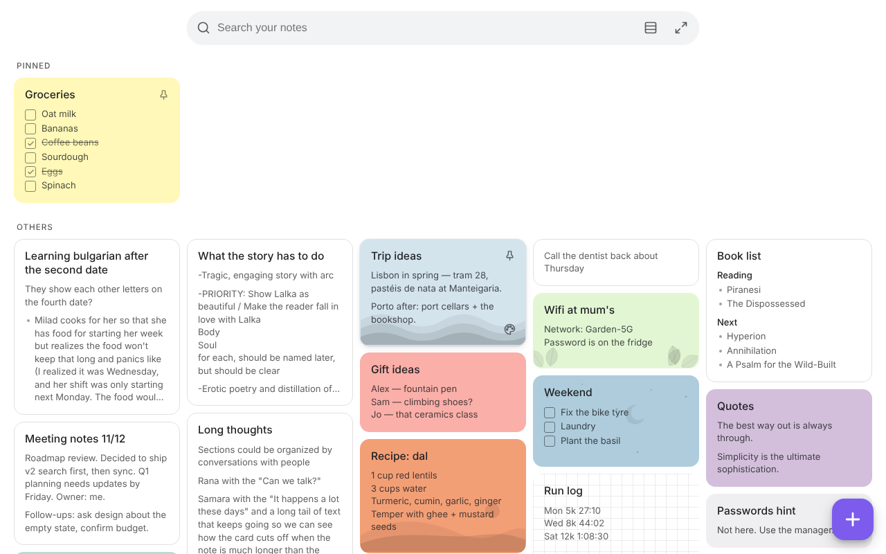

# Yarn

A roomy, card-based home screen for Obsidian, built for phones:

- **Card grid.** Notes appear as cards in a two-column masonry layout (more columns on tablets), newest edited first. Cards load in batches as you scroll, so large vaults stay fast. A button in the search bar switches to a single-column list.
- **Search bar.** Searches note titles and text as you type. Separate words must all match.
- **Big + button.** Creates a note in Obsidian's *Default location for new notes* and opens it ready to type.
- **Colours and wallpapers.** Long-press a card (or right-click it on desktop) to open the sheet. It offers 11 colours, each with light and dark versions, 9 built-in wallpapers, and the option to use any image from your vault as a wallpaper.
- **Pin notes.** Long-press a card and tap **Pin**. Pinned notes stay at the top under "Pinned", and everything else goes under "Others".
- **Hide Obsidian's toolbars.** The ⤢ button in the search bar hides Obsidian's top header and bottom bar while the board is open. Tap it again to bring them back.
- **Tags.** A note's tags (from properties or inline `#tags`) show as one row of chips at the bottom of its card. Tap a chip, or type `#Stories` in the search bar, to see only notes with that tag. Nested tags such as `#Stories/Lalka` count too. Lines that contain only tags are left out of the preview, since the chips already show them.
- **Label picker and search tricks.** Tapping the empty search bar lists all your labels with note counts, plus **Unlabelled**. In the search box, `#unlabelled` finds notes with no tags, and a leading `-` excludes matches (for example `-#Stories` or `-draft`). You can combine terms: `#Stories -#Stories/Lalka`.
- **Label names.** Under Settings → Label names, give a short tag a display name, one per line: `Stories/lalkaomilad = A Portrait of Lalka by Milād`. Cards and the label list show the name, cut off with "…" if it's too long. Searching still uses the tag, and sub-tags keep the name (`A Portrait of Lalka by Milād/Dates`).
- **Google Keep imports.** The Keep importer stores labels as `Keep/Label/Traits`, and Yarn shows those as just `Traits` (`Traits/sub` for sub-labels). Its `Keep/Pinned` and `Keep/Color/…` tags become real Yarn pins and colours, and their chips are hidden. Your notes aren't changed. If you unpin or recolour one of these notes, Yarn saves your choice in the note's properties, and that overrides the Keep tag.
- **Hidden placeholder titles.** Titles like "Untitled 3", or timestamp names that importers give title-less notes (e.g. `2026-11-09T07_08_55.452-05_00`), are hidden on cards. Plain dates like `2026-11-13` still show.
- **Checklists and images in previews.** `- [ ]` tasks show as checkboxes, and the first image embedded in a note appears at the top of its card.
- **Replaces the landing page.** The board opens when Obsidian starts (you can turn this off in settings). Notes open in the same tab, so Back returns you to the board, and the board tries to restore your scroll position and search.

### On desktop (Windows, macOS, Linux)

The same plugin works on desktop, and the phone layout is unchanged:

- Cards get a fixed, roomier width and the grid is centred, like Keep on the web.
- Hover a card to see **colour** and **pin** buttons in its top-right corner. The title wraps around them, so they never cover text. Right-click a card to open the full menu, which appears as a centred dialog.
- **Ctrl/Cmd-click** or **middle-click** a card to open the note in a new tab.
- At startup, Yarn never replaces a note you have open. It reuses an empty tab or opens its own.
- The ⤢ button hides the board's header and collapses both sidebars. Press it again to bring back the sidebars that were open.



Everything is generated locally, and the plugin never loads anything from the internet (remote image links in notes are not shown on cards).

## Where colours are stored

Colours and wallpapers are saved as properties in the note's frontmatter, so they sync with the note:

```yaml
---
card-color: mint            # coral, peach, sand, mint, sage, fog, storm, dusk, blossom, clay, chalk, or a hex value like "#ffcc00"
card-wallpaper: hills       # waves, hills, peaks, night, dots, grid, leaves, confetti, aurora, or "[[some image.jpg]]"
card-pinned: true
---
```

Changing a colour keeps the note's "last modified" time, so the note doesn't jump to the top of the board.

## Install with auto-updates (BRAT)

1. In Obsidian, install **BRAT** from Community plugins and enable it.
2. Open BRAT's settings, tap **Add beta plugin**, and enter `nezamiganjavi/yarn`. If the repository is private, first add a GitHub token in BRAT's settings: a fine-grained token for this repository with read-only "Contents" access.
3. BRAT installs the latest release and checks for updates when Obsidian starts.

## Releasing a new version

1. Bump `version` in `manifest.json` and `package.json`, and add the version to `versions.json`.
2. Push to `main`. The Release workflow builds the plugin and publishes a GitHub release with `main.js`, `manifest.json` and `styles.css`, tagged with that version.
3. BRAT on your phone picks up the new version the next time Obsidian starts.

To release by hand, run the Release workflow from the repository's Actions tab.

## Install on Android (manual)

1. Download `yarn.zip` (or the three files `main.js`, `manifest.json` and `styles.css` from this repo).
2. On your phone, open your vault folder with a file manager and go to `.obsidian/plugins/`. Hidden folders must be visible to see `.obsidian`. Create a folder called `yarn` there. If you installed the earlier "Jotboard" version, delete `.obsidian/plugins/jotboard/`.
3. Put `main.js`, `manifest.json` and `styles.css` inside `.obsidian/plugins/yarn/`.
4. In Obsidian, go to **Settings → Community plugins**. Turn off Restricted mode if it's on, tap the refresh icon, and enable **Yarn**.
5. Restart Obsidian, and the board will be your home screen.

If your vault syncs from a computer (Syncthing, Obsidian Sync with plugin syncing on, etc.), you can do steps 2–3 on the computer instead.

## Settings

- **Open on startup**: show the board instead of the usual landing page.
- **Folder**: only show notes in one folder. Leave empty to show the whole vault.
- **Excluded folders**: hide folders such as Templates.
- **Sort by**: last edited, created, or name.
- **Hide Obsidian toolbars**: the same as the button in the search bar.
- **Card font**: your phone's system font (the default) or Obsidian's interface font.
- **Preview lines**: how much of each note appears on its card.
- **Long note indicator**: end long previews with "…" (the default), a fade, or nothing. Previews always stop at a whole line.
- **+ button colour**: nine presets plus the theme accent, or any colour from the picker. The + sign switches between white and dark automatically so it stays readable.

## Development

```bash
npm install
npm run build      # type-check + bundle main.js
npm run harness    # build the browser test harness, then open harness/index.html
```

`harness/index.html` mounts the real board against a mock vault. Use query parameters to change what it shows: `?theme=dark`, `?sheet=1`, `?q=milk`, `?layout=list`, `?count=0`.
